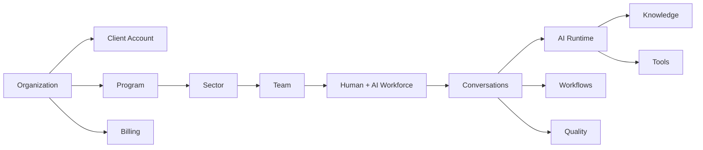

# OMNILINKS

OmniLinks is a multi-tenant Customer Operations Platform for direct businesses and BPO/service providers.

It combines customer conversations, human workforce, AI workforce, channels, knowledge/RAG, authorized business actions, workflows, quality, analytics, billing, and integrations.

## Architecture

OmniLinks starts as a **modular monolith with explicit domain boundaries**.



PostgreSQL is the transactional source of truth. Supporting infrastructure may include Redis, queues/event streams, object storage, and vector/search infrastructure.

Tenant isolation is enforced by server-side authorization and tenant-scoped data access, with PostgreSQL RLS available as defense in depth.

## Repository

```text
OMILINKS/
├── apps/
│   ├── web/
│   └── widget/
├── packages/
│   ├── backend/
│   ├── ui/
│   ├── math/
│   ├── eslint-config/
│   └── typescript-config/
├── docs/
├── package.json
├── pnpm-workspace.yaml
└── turbo.json
```

## Implementation Status

The codebase is built as vertical phases. Status is tracked in separate columns so that code, tests, CI and deployment are never conflated.

- **On main** means the code is in the default branch.
- **Tests** names the backend test file for that phase. The backend suite passed locally on 2026-10-20 with PostgreSQL 16 (219 of 219 tests; 124 pass and 95 are skipped without a database).
- **CI** stays "Pending" until the backend, web, and widget workflows have run on the merge commit.
- **Deployed** is "No" for every phase: no deployment is recorded.

| Phase | Provides | On main | Tests | CI | Deployed |
| --- | --- | --- | --- | --- | --- |
| 0-2 | Tenant, identity, and the conversation/AI core | Yes | `foundation`, `auth`, `app`, `ai`, `phase2-completion` | Pending | No |
| 3 | Web Widget channel boundary with durable inbound-event deduplication | Yes | `channel` | Pending | No |
| 4 | Deterministic workforce routing, queues, capacity, presence, assignment safety | Yes | `routing` | Pending | No |
| 5 | PostgreSQL-backed durable event and worker runtime (retries, leases, dead-letter replay, queue routing) | Yes | `event-runtime` | Pending | No |
| 6 | AI control plane: model registry/failover, guardrails, durable AI traceability, cost attribution, evaluation | Yes | `phase6-ai` | Pending | No |
| 7 | Durable workflow engine (versioned definitions, idempotent triggers, WAIT/APPROVAL states, bounded retries; kernel steps only) | Yes | `phase7-workflow` | Pending | No |
| 8 | Quality kernel (versioned scorecards, deterministic sampling, evidence-linked human review, AI-proposal fencing, remediations) | Yes | `phase8-quality` | Pending | No |
| Operator inbox | Authenticated console in `apps/web` (inbox list, conversation detail, handoff visibility, idempotent human reply) | Yes | `inbox` | Pending | No |

Descriptions are carried over from the previous README and are supported only by the named test files. The Web Widget is the only channel integration in the code; other channels such as WhatsApp are not implemented. Later domains remain target architecture until their implementation and tests land.

## Documentation

1. `docs/README.md`
2. `docs/requirements/functional-requirements.md`
3. `docs/requirements/acceptance-criteria.md`
4. `docs/architecture/HLD.md`
5. Relevant `docs/domain/*`
6. `docs/api/*` and `docs/events/*`
7. `docs/security/*`, `docs/ai/*`, `docs/data/*`
8. `docs/product/*` and `docs/engineering/*`

## Engineering Rules

- Routes/controllers stay thin.
- Domain modules own business rules.
- Provider SDKs stay behind adapters.
- Frontend state is never an authorization source.
- PostgreSQL owns transactional truth.
- Events are at-least-once and consumers are idempotent.
- Tenant scope is established before resource access.
- AI can only perform explicitly authorized actions.
- Payment state is verified server-side.
- A feature is not complete without tests, observability, documented contracts, and failure handling.

## Product Direction

The platform serves both companies operating their own customer operations and BPO/service organizations operating multiple client accounts, programs, sectors, teams, and workforce pools.

Automation providers such as n8n are integrations, not the source of truth for customer, conversation, authorization, or billing state.

## Local Development

```bash
pnpm install
docker compose up -d                                  # PostgreSQL
pnpm --filter @workspace/backend db:migrate           # apply migrations
pnpm --filter @workspace/backend db:seed              # idempotent demo tenant
pnpm dev
pnpm lint
pnpm typecheck
pnpm build
```

Reset the database with `docker compose down -v` followed by migrate + seed.
See `.env.example` for `DATABASE_URL`, `TEST_DATABASE_URL`, and ports.


## Financial & Commercial Integration

Financial and commercial control are first-class engineering constraints. The ordered ticket system in docs/Tickets is authoritative for execution; finance tickets connect build cost, go-live cash, acquisition cost, COGS, MRR, runway, break-even, and capital decisions.

Cross-reference: [Financial Model](../finance/financial-model.md) and [Finance & Commercial Control Tickets](../Tickets/12-finance-commercial-control.md). Economic assumptions remain assumptions until replaced by measured evidence.