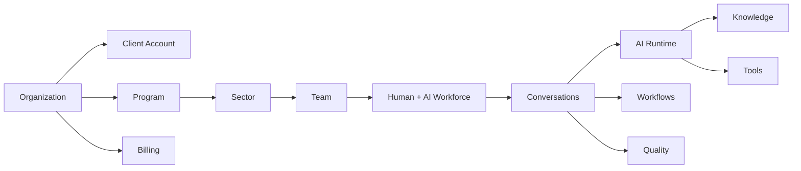

# OMNILINKS

OmniLinks is a multi-tenant Customer Operations Platform for direct businesses and BPO/service providers.

It combines customer conversations, human workforce, AI workforce, channels, knowledge/RAG, authorized business actions, workflows, quality, analytics, billing, and integrations.

## Architecture

OmniLinks starts as a **modular monolith with explicit domain boundaries**.



PostgreSQL is the transactional source of truth. Supporting infrastructure may include Redis, queues/event streams, object storage, and vector/search infrastructure.

Tenant isolation is enforced by server-side authorization and tenant-scoped data access, with PostgreSQL RLS available as defense in depth.

## Repository

```text
OMILINKS/
├── apps/
│   ├── web/                 # Next.js operations application
│   └── widget/              # Customer-facing widget
├── packages/
│   ├── backend/             # Transitional Convex integration
│   ├── ui/
│   ├── math/
│   ├── eslint-config/
│   └── typescript-config/
├── services/
│   └── api/                 # Target Django modular monolith
├── docs/
├── package.json
├── pnpm-workspace.yaml
└── turbo.json
```

## Implementation Status

The repository is undergoing a deliberate backend migration. Status below
describes the canonical tree, not historical implementation snapshots.

| Component | Current canonical state |
| --- | --- |
| Next.js web and widget | Present; the web app currently uses Clerk + Convex |
| `packages/backend` | Convex starter scaffold (`users` schema/functions); transitional only |
| `services/api` | Django foundation introduced by the Python API migration PR; business domains are not yet ported |
| PostgreSQL | Local Compose service; target transactional source of truth for Django |
| Product domains | Requirements and historical TypeScript implementation evidence exist; each capability must be reimplemented and tested in Django before it is considered migrated |
| Production deployment | No production deployment is recorded |

The historical PostgreSQL-backed TypeScript backend referenced by older
implementation tickets exists in Git history but is not present on current
`main`. Its old test results are not current-main CI evidence. ADR-0006 and
[the Django migration plan](docs/architecture/backend-migration-to-django.md)
supersede the previous instruction to restore that implementation as the
target runtime.

**Cutover rule:** keep Convex only for existing callers while migration is in
progress. Each domain has one authoritative write path. Never dual-write the
same business aggregate to Convex and PostgreSQL. Do not build new business
capabilities in Convex.

## Documentation

1. `docs/README.md`
2. `docs/requirements/functional-requirements.md`
3. `docs/requirements/acceptance-criteria.md`
4. `docs/architecture/HLD.md`
5. Relevant `docs/domain/*`
6. `docs/api/*` and `docs/events/*`
7. `docs/security/*`, `docs/ai/*`, `docs/data/*`
8. `docs/product/*` and `docs/engineering/*`

## Engineering Rules

- Routes/controllers stay thin.
- Domain modules own business rules.
- Provider SDKs stay behind adapters.
- Frontend state is never an authorization source.
- PostgreSQL owns transactional truth.
- Events are at-least-once and consumers are idempotent.
- Tenant scope is established before resource access.
- AI can only perform explicitly authorized actions.
- Payment state is verified server-side.
- A feature is not complete without tests, observability, documented contracts, and failure handling.

## Product Direction

The platform serves both companies operating their own customer operations and BPO/service organizations operating multiple client accounts, programs, sectors, teams, and workforce pools.

Automation providers such as n8n are integrations, not the source of truth for customer, conversation, authorization, or billing state.

## Local Development

Start PostgreSQL and the Django API:

```bash
docker compose up --build -d postgres api
docker compose exec api python manage.py migrate
```

The API is available at `http://localhost:8000`. Check
`/health/live/` for process liveness and `/health/ready/` for database
readiness.

For Python development without Docker:

```bash
cd services/api
python -m venv .venv
# Windows PowerShell: .venv\\Scripts\\Activate.ps1
# macOS/Linux: source .venv/bin/activate
python -m pip install -e ".[dev]"
python manage.py migrate
python manage.py test
python manage.py runserver
```

The Next.js apps still use the transitional Convex provider until the
frontend-cutover ticket is completed. Start them with the repository's pnpm
workspace and provide the existing Clerk/Convex environment variables.
See `.env.example` and `services/api/README.md`.

## Financial & Commercial Integration

Financial and commercial control are first-class engineering constraints. The ordered ticket system in docs/Tickets is authoritative for execution; finance tickets connect build cost, go-live cash, acquisition cost, COGS, MRR, runway, break-even, and capital decisions.

Cross-reference: [Financial Model](../finance/financial-model.md) and [Finance & Commercial Control Tickets](../Tickets/12-finance-commercial-control.md). Economic assumptions remain assumptions until replaced by measured evidence.