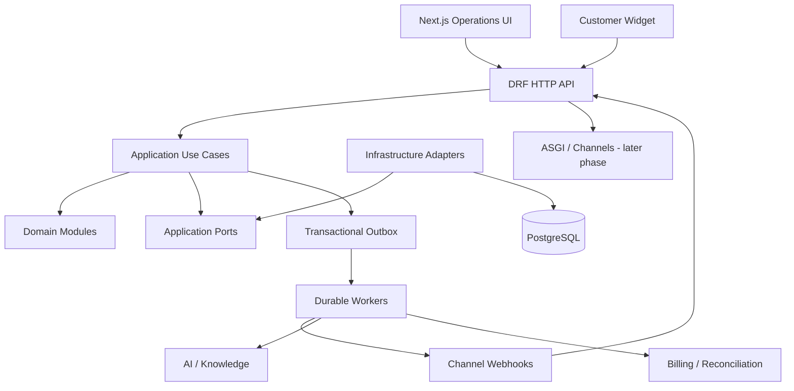

# Backend Migration: Convex to Django

> Status: **Target architecture and migration contract**
> Owner: OmniLinks engineering
> Last reviewed: 2026-11-15

## 1. Why this migration exists

The target product is a multi-tenant customer operations platform for direct
businesses and BPO/service providers. It requires transactional relationships
between organizations, memberships, customers, conversations, assignments,
workforce, workflows, quality records, and billing.

The current default branch has a small Convex starter backend
(`packages/backend/convex/schema.ts` and `users.ts`) and the web application
wraps itself in `ConvexProviderWithClerk`. This is the actual migration
starting point. The PostgreSQL modular-monolith implementation described by
older tickets and historical commits is not present on current `main`.

The migration must therefore reconcile three separate things:

- the product and domain specifications already documented in `docs/`;
- the actual Convex-backed runtime currently on `main`;
- the new Django API introduced under `services/api`.

Do not treat historical implementation notes as evidence that the current
default branch contains those features.

## 2. Target architecture

Use a **modular monolith with N-tier boundaries and domain-driven module
ownership**. These are complementary: the modular monolith is the deployment
shape, N-tier is the dependency separation, and bounded contexts define
business ownership.



### Layers

| Layer | Owns | Must not own |
|---|---|---|
| Presentation | HTTP, serializers, request parsing, status mapping | business rules, direct provider calls |
| Application | use cases, transactions, authorization orchestration, ports | transport-specific behavior |
| Domain | invariants, state transitions, policies, domain events | Django, DRF, ORM, network or provider SDKs |
| Infrastructure | persistence, ORM mappings, repositories, adapters, observability | business policy |

### Module layout

Create a module only when its first real behavior is implemented. A module
may then use:

```text
modules/<bounded_context>/
  domain/
  application/
  infrastructure/
  presentation/
  tests/
```

Do not create dozens of empty Django apps or abstract repositories for
unimplemented domains. A layer exists to enforce a real boundary, not to
decorate a directory tree.

## 3. Technology decisions

| Concern | Decision | Introduction gate |
|---|---|---|
| Web framework | Django 6.1 | foundation |
| HTTP API | Django REST Framework 3.18 | foundation |
| Transactional database | PostgreSQL 16+ | persistence slice |
| Driver | psycopg 3 | foundation |
| ASGI server | Uvicorn | foundation |
| Realtime | Django Channels | first WebSocket requirement |
| Durable async work | PostgreSQL outbox + leased worker runtime | event-runtime slice |
| Cache / channel layer | Redis | only when a real consumer requires it |
| Search/vector | PostgreSQL first; dedicated engine only with measured need | retrieval scale gate |
| Frontend | existing Next.js applications | migrate feature-by-feature |

Do not add FastAPI alongside Django. Do not add Redis, Kafka, Celery,
Elasticsearch, or Kubernetes solely because they are common in SaaS
architectures. Adopt infrastructure only when a concrete use case and
operational requirement justify it.

## 4. Dependency rules

```text
presentation -> application -> domain
infrastructure -> application ports
application -> domain
domain -> standard library / domain-owned contracts only
```

- HTTP views validate transport input and invoke a use case.
- Serializers define wire contracts; they do not enforce cross-aggregate
  authorization or own transaction policy.
- Application use cases establish transaction boundaries and call ports.
- Domain objects enforce state invariants without ORM access.
- Django ORM models and migrations belong to infrastructure.
- Repositories require organization context for tenant-owned records.
- Provider SDKs remain behind adapters.
- Domain code never imports Django, DRF, Redis, a provider SDK, or an ORM model.
- Avoid hidden business behavior in model signals and `save()` overrides.

## 5. Tenant isolation

The server derives the organization context from an authenticated principal
and an active membership or explicit machine binding. A request body,
query parameter, header, or URL organization ID is a selector, never an
authorization grant.

Every tenant-owned repository operation must include the organization
context. PostgreSQL row-level security may provide defense in depth after
the application-level tenant contract is established.

Required negative tests include cross-tenant get-by-ID, list, search, update,
delete, export, event replay, tool invocation, and background-job execution.

## 6. Transaction and event rules

- PostgreSQL is the source of truth for business state.
- A business mutation and its outbox event commit in one database transaction.
- Publication is asynchronous and at-least-once.
- Consumers are idempotent and use explicit leases, bounded retries, and
  dead-letter/replay rules.
- External provider calls never run inside a long-lived database transaction.
- Unknown provider outcomes are reconciled before retries can duplicate a
  customer-visible or billable side effect.
- Realtime notifications are derived from committed state; websocket failure
  cannot roll back a conversation transaction.

## 7. Staged cutover

| Stage | Scope | Cutover condition |
|---|---|---|
| 0 | Django service, health, CI, Docker | this foundation PR passes CI |
| 1 | database migrations, configuration, observability | clean PostgreSQL bootstrap and migration checks |
| 2 | tenancy, identity, membership, authorization | cross-tenant negative suite passes; Clerk integration verified |
| 3 | customers, identities, conversations, messages | transactional invariants and idempotency tests pass |
| 4 | widget/channel adapter and webhook ingress | provider contract, signature, dedupe and retry tests pass |
| 5 | workforce, queues, routing, assignments | concurrency and deterministic routing tests pass |
| 6 | outbox, inbox, worker leases, retries, replay | crash/recovery and duplicate-delivery tests pass |
| 7 | AI, knowledge, tools, workflows, quality | authorization, evaluation and side-effect controls pass |
| 8 | billing, usage, Paymob reconciliation | duplicate callback and ledger reconciliation tests pass |
| 9 | frontend migration and data reconciliation | all active callers use Django; parity and rollback evidence exists |
| 10 | remove Convex | no production reads/writes, imports, jobs, or data dependencies remain |

A stage is not complete because its files exist. Its acceptance evidence must
include implementation, positive and negative tests, failure/recovery tests,
observability, migration safety, documentation and CI.

## 8. Convex transition policy

- Leave the existing Convex integration running until callers are migrated.
- Do not build new business capabilities in Convex.
- Do not dual-write the same aggregate to Convex and PostgreSQL.
- During transition, assign each aggregate/domain exactly one write owner.
- Migrate existing records with explicit counts, checksums or domain-specific
  reconciliation; do not assume a clean database because the schema is small.
- Remove the Convex provider and dependencies only after a repository-wide
  import/call-site audit and a verified cutover.

## 9. Clean-room product implementation

Chatwoot is a product reference, not a source-code base for the Python
implementation. Implement requirements from OmniLinks' own product
specifications, domain invariants, API contracts and independently observed
customer workflows. Do not copy or translate proprietary Enterprise code,
tests, or implementation-specific documentation. Keep third-party notices
for code that is actually reused under its license.

## 10. Definition of migration complete

- the Django API owns all required business writes;
- the UI, widget, provider webhooks and workers use documented API contracts;
- all domains have tenant-isolation and failure tests;
- data reconciliation is signed off;
- no production Convex dependency remains;
- backup/restore, monitoring, deployment, incident and rollback runbooks
  are tested against the final runtime.
